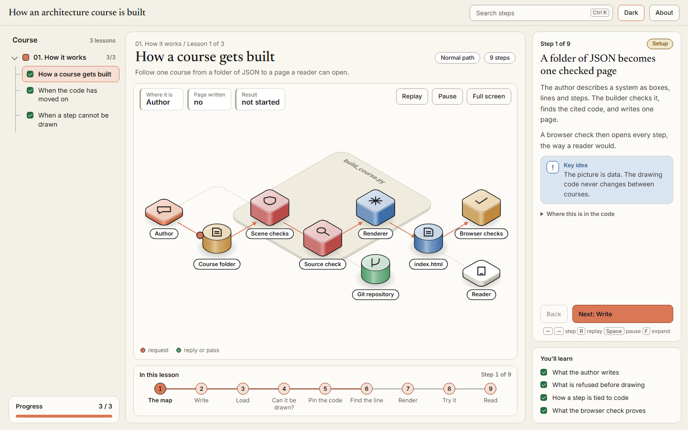

# Architecture Course

A Claude Code skill that turns a description of your system into an animated, step-through course page.
Every step points at a real line of code, and the build stops if that line is gone.



- **One file out.** A standalone `index.html`: no server, no framework.
- **Tied to code.** You cite exact text; the builder finds the line at a fixed commit.
- **Shows failure too.** The normal path and what goes wrong share one diagram.
- **Checked in a browser.** Every step at desktop, tablet and phone size, plus both themes and reduced motion.

## Install version 1.0.0

Run this in a Bash shell:

```bash
git clone --branch v1.0.0 --depth 1 https://github.com/gblack686/architecture-course
mkdir -p ~/.claude/skills
cp -r architecture-course/skills/architecture-course ~/.claude/skills/
```

The [release page](https://github.com/gblack686/architecture-course/releases/tag/v1.0.0) lists the exact
commit and a zip with its SHA-256. Then ask Claude Code: *"Make an architecture course of how login works in
this repo."* The skill is plain Markdown and scripts, so other agents can use it too.

## Use it by hand

Needs Python 3.10 or newer and git.

```bash
python skills/architecture-course/scripts/build_course.py examples/how-it-works --repo architecture-course=.
```

Open `examples/how-it-works/index.html`. That example explains how this skill itself works. To write your own,
see [the course format](skills/architecture-course/references/course-format.md).

## Check a page

```bash
pip install -r requirements-dev.txt
playwright install chromium
python skills/architecture-course/scripts/check_course.py examples/how-it-works/index.html
python -m pytest -q
```

## What it does not do

It proves that a cited line exists and that the page can be read. It cannot tell whether the explanation is
right, so read it before you share it. A page embeds everything in its course, so keep secrets out.

## Credit and license

The idea of a three-column, step-through system design course comes from
[Designed to Scale](https://designed-to-scale.vercel.app) by Dilum Sanjaya. This is a separate project, not
affiliated with it. The code and drawings here were written from scratch; none of that site's are included.

[MIT](LICENSE).
